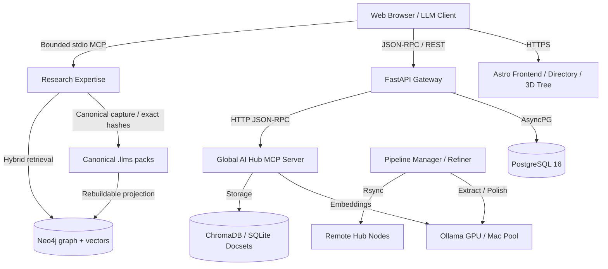

# LLMS-Explorer Architecture

## System Overview

LLMS-Explorer is an integrated platform providing documentation exploration for LLMs, semantic search indexing, accounts/metering infrastructure, and an interactive web portal.

## Architectural Components

1. **Frontend (`site/`)**:
   - Built with Astro static generation and TypeScript, styled with plain CSS (`site/src/styles/`).
   - Hosts the directory of llms.txt sources, 3D force-directed concept graph, documentation viewers, and account islands.
   - Postbuild tools generate twin format endpoints and llms.txt indexes.

2. **API & Metering Service (`api/`)**:
   - Built with FastAPI, SQLAlchemy 2.0 (asyncio), and asyncpg.
   - Enforces append-only accounting in PostgreSQL via database triggers.
   - Implements authentication via WebAuthn passkeys and OAuth (GitHub/Google).
   - Manages API keys with Argon2id hashing and daily spend limits.
   - Handles Stripe subscription lifecycles and invoice idempotency.

3. **Global AI Hub (`hub/`)**:
   - Python-based semantic ops and document refinement pipeline.
   - Distributes embedding workloads across a multi-host Ollama pool (`embed_core.py`).
   - Maintains ChromaDB collections and SQLite BM25 full-text search indexes for documentation corpora.
   - Exposes standard MCP tools via `mcp-server/hub_mcp_server.py`.

4. **Standard Library & CLI (`llmsx/`)**:
   - Reference parser, validator, and generation tooling for llms.txt specification v2.

5. **Community Directory (`api/routes/contribute.py`, `/contribute`, `/proposals`, `/moderate`)**:
   - Signed-in users can contribute new concepts to the tree via `/api/contribute`.
   - Endpoint runs `concept-abstract-mini` skill (bounded LLM pass), persists artifact, submits moderation proposal.
   - Uses dual-auth (session cookies + API keys); session-based calls require CSRF header.
   - Proposals queue in moderation.py's system; moderators review and accept/reject via `/api/proposals`.
   - Three pages: `/contribute/` (submission form), `/proposals/` (user's own proposals), `/moderate/` (moderator queue).

6. **Concept Hierarchy (`concept-tree/`)**:
   - Contains the core hierarchical data structure (`tree.json`) that maps conceptual relationships.
   - Powers the 3D concept graph visualization on the frontend.

7. **Utilities (`scripts/`)**:
   - Helper scripts for tasks like concept pack building, tree merging, and snapshot refreshing.

## Local research expertise decision

Canonical `.llms` files remain authoritative. The standalone
`hub/research-expertise/` package projects them into Neo4j and computes pinned
CPU embeddings without starting the hub's legacy Ollama pool. Capture preserves
source snapshots and exact quotations before indexing. Save-time mechanical
checks grant no native evidence qualification. Search rechecks canonical hashes
and returns unreviewed status explicitly. See [the package guide](../hub/research-expertise/README.md)
and [the native concept contracts](architecture/concept-knowledge-contracts.md).

## Skill source and immutable release decision

The standalone `hub/skill-registry/` package keeps source guides authoritative.
SQLite FTS5 is a rebuildable local routing index. A source read rechecks the
complete hash and returns a bounded span with its resource base. Bundles bind
all accepted resources to checksums and executable flags; installation does not
overwrite an existing directory.

The hosted FastAPI adapter reuses account identities, scoped API keys and
explicit per-release grants. It accepts private releases and queues jobs using
the existing relational Job model. HTTP does not import uploaded code, execute
commands or publish candidates automatically. A deliberately configured local
worker may execute the native optimizer in a private candidate workspace.
Execution, checks, reported convergence and publication remain distinct.
See [the package contract](../hub/skill-registry/README.md) and [[skill-registry]].
