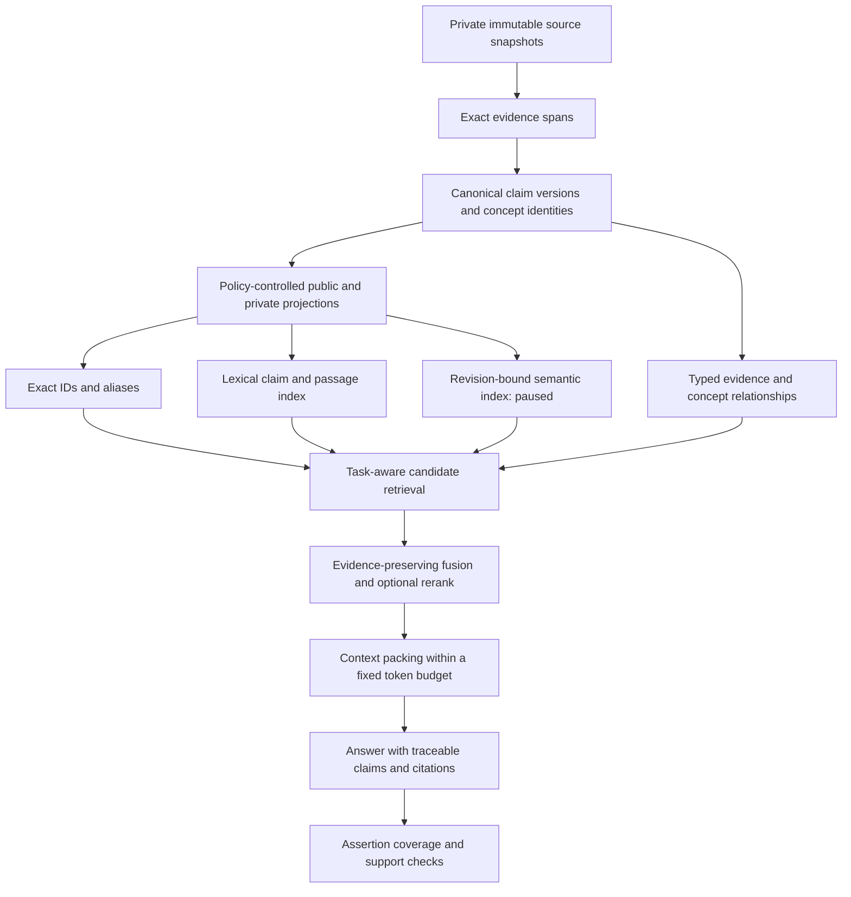

# Recommended concept knowledge strategy

The strongest next investment is a trustworthy evaluation set plus explicit
retrieval-unit and representation identities. Keep the existing canonical
artifact and immutable-evidence architecture. Measure retrieval and research
quality before choosing another embedding model or storage engine.

This is a project recommendation derived from the verified implementation and
seven depth runs in three [dossier files](dossiers/). It is not a measured quality improvement.
No production strategy changes or embeddings were executed.

## What the evidence changes

The [implementation inventory](current-system.md) establishes concrete gaps:
most website packs exceed the retained search prefix; page-valued fusion IDs
can collapse chunks and credit a page repeatedly; frozen vectors lack exact
input revision bindings; and auxiliary prose falls outside semantic claim
judgments. The [read-only RRF diagnostic](diagnostics.json) reproduces one of
those mechanisms with the current code. It is not a user-relevance benchmark.

The literature narrows several tempting assumptions:

- A low novelty rate is a workflow stopping observation. It does not establish
  calibrated recall over an unknown web universe. Finite-pool statistical
  stopping requires additional sampling assumptions. [Callaghan and Müller-Hansen](https://link.springer.com/article/10.1186/s13643-020-01521-4).
- Claim support, assertion coverage, source trust, and answering completeness
  are separate properties. A supported-fact fraction can rise when useful
  information disappears. [AIS](https://arxiv.org/html/2112.12870v2),
  [FActScore](https://aclanthology.org/2023.emnlp-main.741.pdf).
- RRF has no universal relevance advantage over score fusion. Candidate depth,
  score calibration, and the treatment of missing candidates matter.
  [Bruch et al.](https://arxiv.org/html/2210.11934v2).
- Atomic propositions, generated context, and contextual token pooling alter
  different stages. Their reported gains do not prove a win on this corpus.
  Irrelevant surrounding text can hurt contextual pooling.
  [Dense X](https://arxiv.org/html/2312.06648v3),
  [Late Chunking](https://arxiv.org/html/2409.04701v3).
- Immutable published artifacts may already answer audit questions that would
  otherwise motivate a bitemporal database. First establish which effective-time
  queries callers need. [Fowler](https://martinfowler.com/articles/bitemporal-history.html).
- Same dimensions do not prove compatible embedding spaces; a provider can
  explicitly guarantee compatible model families. Migration must name the
  compatibility contract. [Voyage migration guide](https://www.mongodb.com/docs/voyageai/tutorials/migrate-embedding-model.md).
- Dual writes and backfill do not automatically preserve deletes or a current
  rollback target. A static corpus can use a simpler pinned rebuild.
  [Qdrant migration procedure](https://qdrant.tech/documentation/tutorials-operations/embedding-model-migration/).

## Architecture to evaluate

The source library remains private. The canonical artifact remains authoritative.
Indexes, contextual text, summaries and vectors are derived representations.
A generated context sentence cannot become evidence merely because retrieval
found it. Public/private filtering applies before indexing and again when
packing context. This is a proposed extension of existing policy boundaries.

Use distinct identities for a concept, a statement version, a source version,
and a retrieval unit. Preserve several useful chunks from the same page.
Keep deduplication, fusion identity and final source diversity as separate
decisions. Exact identity resolution can precede a broader lexical or semantic
query. A bounded relationship traversal is an experimental arm for questions
whose correct evidence spans several concepts; a concept-name hierarchy alone
does not establish an evidence entailment graph.

Bind each index revision to the canonical artifact, exact encoded text,
unit/granularity, model revision or documented compatibility family,
preprocessing and task prompts, dimensions, normalization, distance convention,
query encoder, cache namespace, exclusions, and evaluation receipt. Existing
vectors whose historical inputs are unknown must remain labeled unknown.
Hashing today's text would not reconstruct their historical provenance.

For volatile assertions, add optional effective-time or version applicability
only when known. Retain recorded time and supersedes/retracts relationships.
Never infer the fact's effective date solely from publication, fetch, or
verification time. This envelope is additive; a storage-engine migration is
not established as necessary.

## Recommendations, evidence and experiments

Priority indicates proposed order, not an estimated effect size.

| Priority | Recommendation and expected value | Evidence / confidence | Cost and tradeoff | Decisive experiment |
|---|---|---|---|---|
| 1 | Measure factual-assertion coverage across summaries, disagreement notes and rendered prose | Current gap verified in code and Stele KNOW-796; local quality lift unmeasured | Extraction can omit qualifiers or create false blocks | Supported-claim-only rendering versus assertion extraction versus current gate; human-labeled hard cases |
| 1 | Establish task-stratified retrieval judgments and a lexical baseline | No representative concept-evidence benchmark found; published results vary by task | Labeling and adjudication effort | Frozen corpus, held-out concept families, blinded pooled judgments and per-task metrics |
| 2 | Preserve chunk/claim identity and at most one fusion contribution per unit per list | Existing RRF fixture reproduces rank inflation and snippet loss | Correct identity may change page diversity and ordering | Replay fixed rank lists with duplicate chunks, shared URLs and alternate evidence sets |
| 2 | Index later claim/passage evidence instead of relying solely on a concept prefix | Truncation established; relevance cost unmeasured | More units increase index and context-selection work | Same corpus and encoder; concept-prefix versus claim/passage candidates at equal answer-token budgets |
| 2 | Add representation revision metadata and mismatch checks | Frozen-vector and query-cache contract gaps verified | Historical inputs may be unavailable; metadata alone cannot fix vectors | No-embedding mismatch fixtures, ID/hash/exclusion validation and encoder/index/cache cutover rehearsal |
| 3 | Test hybrid lexical/dense fusion and reranking separately | Primary fusion studies conflict under different protocols | Candidate depth and reranking add latency; score weights can overfit | Single channels, corrected RRF and tuned score fusion; then fixed-pool rerank ablation |
| 3 | Compare deterministic context before generated context or late chunking | Existing atomic facts supply a credible baseline; literature gives counterexamples | Generated context can add unsupported information; pooling needs suitable encoder | Plain unit, deterministic heading/version context, verified generated context and contextual pooling |
| 3 | Calibrate research stopping to late decision-changing findings | Existing novelty rule is observable; completeness guarantee unsupported | Extra continuation audits cost research time | Hidden continuation passes on frozen finite source pools and varied concepts |
| 4 | Add temporal fields or bounded graph traversal where judged tasks require them | Mechanisms credible; local workload demand unknown | More annotations and relationships create maintenance obligations | Historical/current-view fixtures and multi-concept complete-evidence tasks |
| 4 | Change embedding model or database only after earlier comparisons | No model or database winner established here | Rebuild, operational complexity, privacy and rollback costs | Candidate revision using its own matching query encoder, held-out quality/cost comparison |

## Controlled evaluation plan

Create one versioned collection containing the source snapshot, canonical
artifact hashes, unit IDs, questions, relevance judgments, alternate sufficient
evidence sets, and assessor decisions. Keep benchmark inputs private when they
contain private source material. Public publication should expose only approved
questions and aggregate results.

Use real tasks plus independently authored difficult cases. Split by concept
family and information need, so paraphrases of one question do not leak between
development and holdout. Choose a pilot size for rubric calibration, then use
its paired variance to plan the main sample. A convenient fixed sample size is
not a power calculation.

| Task | Primary retrieval measure | Additional outcome | Difficult cases |
|---|---|---|---|
| Exact name, symbol or claim | Success@1; MRR@10 | Correct stable identity and requested version | Aliases, punctuation, near-identical symbols, renamed concepts |
| Paraphrased question | Graded nDCG@10; judged evidence recall | Answer correctness and citation support | Vocabulary mismatch, abbreviations, lexical distractors |
| Multi-concept question | Required-evidence-group recall; complete-set success | Qualifier/bridge preservation within token budget | One highly ranked source with another required source missing |
| Conflict, staleness or supersession | Conflict-pair coverage; applicable-version accuracy | Harmful stale-selection rate and provenance | Unknown effective date, late corrections, mirrored stale claims |
| Missing coverage / no answer | Human-reviewed gap precision; false-gap rate | Appropriate abstention | Existing coverage under another name and genuinely absent evidence |

Pool candidates from every comparison arm and randomize assessor presentation.
Hide producing systems. Double-assess rubric calibration and disputed cases.
Keep original labels and disagreements. Track unjudged rates at each cutoff.
LLM-generated assessments can enlarge a provisional pool, but validate agreement
against human-held-out judgments by task; do not silently replace the reference.
The empirical agreement and measurement-validity dispute remain separate.
[TREC protocol](https://trec.nist.gov/howto.html),
[TREC 2024 assessment study](https://arxiv.org/abs/2411.08275),
[NIST validity argument](https://tsapps.nist.gov/publication/get_pdf.cfm?pub_id=958495).

Run changes in stages so each comparison has a clear cause:

1. **Research quality:** compare fixed research budgets, current novelty stopping,
   and a calibrated candidate rule on the same source pool/model. Hide
   continuation findings until each arm proposes a stop. Count supported unique
   mechanisms, late decision changes, missing counterexamples, time and cost.
2. **Storage contract:** compare existing artifacts with an optional temporal
   assertion envelope on late corrections and historical-view questions. Count
   incorrect dates, wrong evidence identity, storage and annotation effort.
3. **Retrieval identity and lexical coverage:** use frozen text and existing or
   synthetic rank lists; no embeddings needed. Compare exact lookup, current
   lexical behavior, full-unit BM25 and once-per-list unit-aware fusion.
4. **Representation:** hold model, corpus, filters and reranker fixed. Compare
   plain units, deterministic context, generated context and multiple
   granularities. Hold answer-token budget fixed; equal k is not equal context.
5. **Fusion:** hold the candidate union fixed to compare formulas; separately
   vary channel depth to measure candidate recall. Tune weights only on
   development topics. A proposed depth grid is 20/50/100/200 and damping grid
   20/60/100; these are experiment settings, not recommended defaults.
6. **Reranking and context:** compare no reranker, the current cosine reranker,
   and a specified cross-encoder on the same candidates. Compare context packing
   on the same ranked lists. Keep generation model/prompt fixed for answer tests.
7. **Embedding revision:** after separately authorizing computation, compare
   complete revisions with their matching query encoders. Pin preprocessing,
   corpus and hardware. A domain-training arm requires suitable labels and its
   own held-out split; a leaderboard score does not select a local winner.

Report per-query and per-task deltas, paired topic-level uncertainty and failure
examples. Measure evidence support and answering completeness separately.
Record p50/p95/p99 latency, cold/warm caches, hardware/concurrency, index bytes,
build time, model calls, provider-reported cost or an explicit unknown, and
maintenance effort. Set minimum useful benefit and resource ceilings before
holdout evaluation. Reject claim/identity corruption even when an average
ranking metric improves. Do not declare a winner when uncertainty or a sparse
task stratum prevents the intended conclusion.

No full retrieval benchmark, model comparison or re-embedding ran in this
research. Existing narrower experiments remain precedents, not substitutes.

## Staged implementation and rollback proposal

1. **Inventory and baseline — completed here.** Preserve the architecture
   evidence and failure reproducer. Next create the judgment rubric and corpus
   fingerprint. No migration is needed for this stage.
2. **Quality and identity — proposed.** Add auxiliary-prose coverage measurement,
   exact retrieval-unit IDs and revision validation. Keep immutable statement
   and source identities. Feature-gate any retrieval change; retain the current
   candidate generator and complete configuration for rollback.
3. **Lexical and representation experiments — proposed.** Build candidate indexes
   beside the active index. Compare at equal corpus and context budgets. Keep
   current results if the candidate lacks a useful held-out gain.
4. **Semantic revision — proposed, embeddings still paused.** Prefer a static
   build from a pinned canonical artifact. Validate complete IDs, hashes,
   exclusions and row alignment. Switch index, matching query encoder and cache
   namespace as one configuration object. Rehearse restoring the old object.
5. **Live migration only if required — proposed.** Define ordered changes,
   delete tombstones, replay watermarks and reconciliation. Continuing only new
   writes means an old index is no longer a current rollback target. A successful
   alias operation is not proof that the two datasets are equivalent.
6. **Ongoing research refresh — proposed.** Refresh volatile claims based on
   source/version applicability and validated workload need. Preserve evidence
   and prior published views; do not overwrite history to make it look current.

The stop/keep-current conditions are explicit: preserve current storage when
existing artifacts answer the required history queries; preserve current fusion
when changes add no useful judged evidence; reject enrichment that increases
unsupported assertions or qualifier loss; and preserve the active embedding
revision when a complete coherent candidate does not meet the predeclared
quality/cost rule.

## Open questions

The next research queue contains stopping-rule sequential calibration, rare
decision-changing findings, temporal relevance judgments, evidence-set identity,
query-intent routing, cross-encoder tradeoffs, and adaptive fusion worst-case
cost. These do not establish a need to replace the present stack. They identify
which bounded follow-up could change an implementation decision.

All seven depth runs reached the default six-pass cap while productive. Their
dossiers preserve the actual curves and remaining gaps. The bounded run can
produce useful recommendations without claiming depth or frontier saturation.
