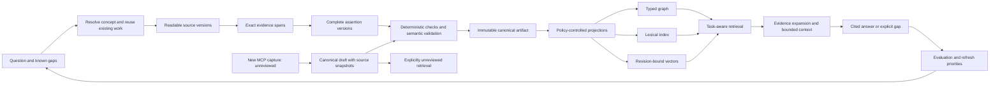

# Research from question to reusable expertise

Version: 1.0.1. Delta: record implemented repairs and source checks for prompt138 and TASK-1315.
Baseline: remote main `3dd863b0`; measurements below precede this audit's repairs.

The most useful next step is to connect the existing assertion-level evidence
contracts to the new retrieval service. Keep canonical research authoritative.
Treat the graph, vectors, website and search databases as versioned projections.
Measure whether an agent can find sufficient, current evidence for a task before
selecting another model or adding generated graph summaries.

This audit reviews pipeline behavior and architecture. It does not independently
validate every imported fact, establish frontier saturation, or demonstrate a
relevance improvement. The bootstrapper and code optimizer have separate scope
and verification receipts; source inventory is not equivalent to reviewed code.

## What the data shows

The read-only [baseline observation](research-lifecycle-audit-2026-11-11/metrics-before.json)
records manifest metadata, application status and aggregate Cypher. It contains
no source bodies or credentials. Files and the database were observed live;
these reads are not one atomic cross-store snapshot.

| Observation | Baseline | Meaning |
| --- | ---: | --- |
| Immediate pack manifests | 2,351 | Broader than importable prose; includes manifest-only/excluded packs |
| Eligible prose documents / stored documents | 2,318 / 2,318 | Matching counts, not proof that every stored document is fresh |
| Stored passages / vectors | 45,786 / 45,786 | Coverage, not a retrieval-quality score |
| Eligible manifests with canonical artifact and concept IDs | 1,062 | An available bridge to canonical identities; receipt verification is still required |
| Stored documents marked `unreviewed` | 2,318 | Honest current qualification of this prose projection |
| Eligible capture manifests with member hashes | 1 | The new capture format has stricter member-integrity semantics than legacy packs |
| Stored document `model_revision` / `embedding_identity` properties | 0 / 0 | Baseline did not persist these bindings; code constants alone cannot establish row identity |

`corpus.iter_documents` imports one preferred prose rendering from immediate
manifest-backed packs. It excludes staging/backups and raw source libraries.
Document URL edges mean that a document cites a URL. They do not mean that the
URL supports every passage or assertion in that document. The concept graph
imports explicit navigation and labels it as navigation.

## Implemented repairs

The optimizer confirmed and repaired four High and ten Medium defects. Its
scope and per-file coverage receipt are separate from the repository inventory;
this does not establish that every repository file has been reviewed.

| Severity | Failure trigger | Implemented behavior |
| --- | --- | --- |
| High | Change a model pin under the same model name | Cache keys, document reuse and dense candidates bind the complete embedding-space recipe. Old unbound vectors require an explicit refresh. |
| High | Two projection writers encounter the fixed `.projection-tmp` sibling | Writers use exclusive owned temporary files; rollback does not delete another writer's sibling. |
| High | A projection destination contains `..` | Canonical destination checks protect the actual preimage, retaining the existing final-symlink refusal and symlinks inside directory snapshots. |
| High | A saved source-version receipt keeps its body hash but changes source identity/path | Archive reuse validates core source/snapshot identity fields before returning a receipt. |
| Medium | Capture supplies source IDs differing only by case | Validation rejects the collision before publication on case-insensitive filesystems. |
| Medium | A canonical capture saves but its index refresh fails | A safe stderr warning records slug and error class without logging source bodies or exception text. The capture remains pending. |
| Medium | Source and claim contain exact `1e6` or `10_000` | Literal preflight accepts scientific/underscore number syntax while retaining negative boundary checks. |
| Medium | A synchronous MCP operation runs on the protocol event loop | Async wrappers serialize operations on one owner thread, keep SQLite thread affinity, and close resources on that thread. Cancellation does not falsely undo completed writes. |
| Medium | CLI starts without usable private connection configuration | The command exits3 with setup guidance and required keys, without traceback or credential content. |
| Medium | Reingest changes a document between explorer metadata and passage reads | Snapshot selection binds document/manifest versions and rechecks freshness instead of combining revisions. |
| Medium | Dependency installation fails during an application upgrade | Installer retains a complete application/venv preimage and restores it on failure. It refuses an upgrade while ingestion owns the lock. |
| Medium | Default Python3.15 cannot install the supported ONNX wheel | Installation selects supported Python3.14; package metadata excludes unsupported Python3.15. |
| Medium | Two same-URL source refreshes interleave wrapper archival/fetch steps | The wrapper serializes its same-source writers so neither successfully fetched body disappears before archival. Direct upstream writers remain a separate integration boundary. |
| Medium | Retired vectors occupy the ANN candidate limit before active-document filtering | Retirement removes their derived embedding property while retaining document/passage text and cached vectors. An isolated actual Neo4j reproduction changes from no result to the active semantic match. |

The owning sources are `hub/research-expertise/src/research_expertise/` and its
installer, plus `scripts/research_gate.py`, `scripts/research_provenance.py`,
`scripts/research_transaction.py` and `scripts/research_library.py`. Maintained
Codex runtime companions are synchronized through the existing helper.

The standalone package passes130 tests and Ruff. Regression checks reproduce
the defects with isolated files, fixed vectors and controlled concurrency.
Installer acceptance also runs actual `uv`: fresh install, executable use,
forced failure with exact full-venv restoration, and successful upgrade. These
checks do not demonstrate retrieval relevance or grant semantic qualification.

The optimizer reviewed17 production files with complete bounded reads. The
repository-wide inventory is broader, and unaudited files remain explicitly
listed in its coverage receipt. Its final status is `BLIND-AUDIT-DISSENT`:
the second independent gate found the retired-vector defect. That defect was
subsequently repaired and verified with a targeted real-Neo4j red/green test.
The two-gate cap is retained; this report does not relabel the run as CLEAN.

The dedicated CPU refresh completed with exit0: 2,318 documents updated,
45,786 passages written and 3,218 explicit navigation relations. Canonical prose
remains authoritative; qualification remains unreviewed. Final installed-state
acceptance and source-delivery receipts are recorded separately.
After the final retirement repair, a repeat refresh exits0 with 2,318 unchanged
documents and zero passage/vector rewrites.

## One authority, several contracts

Use distinct identities for the information and its representations:

| Object | Identity and contract |
| --- | --- |
| Concept | Stable ID plus aliases and ownership; a renamed title must not create another topic accidentally |
| Assertion version | Complete statement, conditions, applicability and source/evidence identity; changed meaning creates another version |
| Source version | Acquired readable bytes, content hash, URL, extraction status and declared origin/derivation |
| Evidence span | Source version plus exact Unicode offsets and quotation |
| Validation attempt | Contract version, exact assertion/evidence bindings, verdict, reviewer and unresolved conflicts |
| Canonical artifact | Immutable content-bound compilation of accepted assertions and their evidence; legacy states remain explicit |
| Retrieval unit | Exact passage or assertion projection, input hash, canonical/source identity and chunk boundaries |
| Embedding | Retrieval input plus model repository/revision, dimension, tokenizer/preprocessing and vector binding |
| Answer | Question, selected evidence, omitted required evidence, citations and a bounded context budget |

The native research pipeline already implements much of the first six rows.
`research_gate.py` selects all v4 assertions for semantic review, checks authored
evidence for structured claims and explicitly attributed disagreements before
review, binds semantic judgments, and blocks unresolved conflict. Ordinary
summary/question prose receives semantic review and supported-output span
checks; it does not have the same authored-span preflight. Deterministic checks
do not prove extraction completeness or semantic entailment by themselves.
`research_artifact.py` preserves canonical claim IDs, evidence IDs,
qualification and auxiliary assertions. `research_provenance.py` preserves
immutable snapshots, origin annotations and evidence spans.

> ⚠️ `SUPPORTED`, quotation equality, indexed coverage and current file hashes
> answer different questions. None can substitute for the others. Historical
> v2/v3 and legacy records retain their original meaning.

The capture-to-native-validation bridge and typed assertion graph in this diagram
are proposed extensions. Current capture saves source-grounded drafts and
retrieves them as unreviewed; it does not invoke the native semantic gate.

## Improvements by stage

| Stage | Keep | Improve next | Acceptance check |
| --- | --- | --- | --- |
| Question and concept discovery | Existing concept ownership, aliases, source-sharing cohorts, scout handoffs and held reservations | Make an explicit decision brief: question, target software version, existing answer, missing evidence and decision-changing novelty. Resolve aliases before queueing. Store negative search results with scope and expiry. | A paraphrased repeat resolves to the same concept/work. Held work is not dispatched again. An empty queue does not claim universal completeness. |
| Source acquisition | Shared readable sources, immutable snapshots, exact spans and origin/derivation metadata | Schedule refresh by volatility. Use conditional HTTP requests where supported. Distinguish fetched bytes, usable extraction and researcher-read evidence. Record original versus derivative sources. | Missing fields, negation or incomplete extraction block qualification; unchanged bytes preserve the source version and its reusable judgments. |
| Fact extraction | Full assertion identity, applicability fields, qualifiers and exact quotations | Preserve atomic claim structure in retrieval: actor, condition, behavior, limit, version and uncertainty. Link several necessary spans instead of truncating a qualified claim. | Splitting does not lose a condition or numeric unit. The complete assertion can be reconstructed with its supporting spans. |
| Validation | v4 all-assertion semantic review, authored-span preflight for structured claims and attributed disagreements, conflict checks and exact unchanged-judgment reuse | Expose separate dimensions for support, coverage, source independence, applicability and freshness. Route new MCP captures into a review queue using the existing gate. | Saving a quote cannot mark a finding supported. A changed assertion/span invalidates only affected reviews; unresolved conflicts prevent qualified promotion. |
| Canonical storage | Immutable artifacts, preimages/journals, explicit legacy states and canonical-first MCP capture | Build one read adapter for canonical assertion/evidence records, shared by projection consumers. Add a projection refresh receipt keyed to canonical artifact identity. | Rebuilding a projection preserves claim IDs and qualification. A projection failure retains canonical work and reports pending refresh. |
| Graph projection | Explicit navigation, concept/document/passage/source nodes and bounded traversal | Add `ClaimVersion`, `SourceVersion`, `EvidenceSpan` and `ValidationAttempt`; distinguish `CITES`, `SUPPORTED_BY`, `CONTRADICTS` and `SUPERSEDES`. Only populate stronger edges from verified native bindings. | A document citation cannot create a support edge. Traversing a contradiction returns both exact positions, their versions and evidence. |
| Embeddings | Local pinned encoder, token-aware exact spans, unchanged-text reuse and incremental ingestion | Persist the complete embedding-space identity, check it before reuse/query, and give legacy migration an explicit bounded rule. Later compare deterministic heading/version context and chunk sizes on held-out tasks. | Revision/preprocessing changes cannot reuse incompatible vectors. Same dimensions alone do not permit reuse. Token budget tests use the actual tokenizer. |
| Retrieval | Lexical+dense candidates, RRF, exact passage expansion and freshness checks | Push concept/qualification/version filters into candidate generation where possible. Return retrieval diagnostics, underfill reasons and missing-evidence groups. Compare lexical-only, dense-only and hybrid before reranking. | Narrow-filter and late-fact tests find eligible evidence. Stale candidates do not crowd out valid results silently. Ranking reports do not call unjudged results irrelevant. |
| LLM context and answering | MCP bounds, source paths/hashes, explicit unreviewed status and data-as-data instructions | Add evidence expansion by stable claim ID and context packing by token budget, retaining qualifiers and conflicting evidence. Keep a concise answer trace. | Each factual answer assertion maps to sufficient retrieved evidence. Missing support produces a qualified answer or gap; retrieved instructions cannot redirect the agent. |
| Natural saving and reuse | Search first, canonical-first sourced capture, CAS updates, idempotent retry and retained revisions | Make the normal research workflow end with canonical save, specific-document index readback and a paraphrased retrieval check. Track review state independently. | An identical replay writes no new passage vectors. `indexed=false` never becomes a success claim. A repeat question reuses the saved result without new web research. |
| Sharing and operations | Private portable bundles with checksums, no credentials, local MCP and installed-state verification | Add projection health/lag reporting and bundle-level rights/access labels. For shared network access, design authenticated scoped retrieval and separate ingestion credentials before exposing a service. | A bundle reconstructs identities and provenance on another machine. Unauthorized clients cannot retrieve restricted sources. Coverage and qualification remain visible after transfer. |

These changes extend existing mechanisms. They do not require another database,
an automatically generated ontology, or another copy of the authoritative prose.

## Priority features with bounded implementation plans

1. **Canonical assertion retrieval and review bridge.** Check canonical internal
   identity with `research_artifact.verify` and verify native support through
   `research_gate.verify_current`, its trusted gate-attempt receipt and immutable
   source/span bindings. An equivalent accepted archived receipt can establish
   historical support under its recorded contract; it does not establish current
   applicability. The artifact's self-consistent hashes or authored verdicts
   alone cannot qualify a claim. Project stable claim/evidence/validation IDs
   beside passages. Add a bounded `expertise_claim` lookup and explicit review
   queue for captures. Preserve `LEGACY-UNBOUND`, `NOT-SAMPLED` and unreviewed
   states. Start with a synthetic v4 artifact, one historical artifact and one
   capture. A malicious authored `SUPPORTED` label must fail to upgrade a result.

2. **A versioned retrieval evaluation collection.** Freeze corpus and encoder
   identities, queries, judged units and alternate sufficient evidence sets.
   Split by concept family/information need rather than by paraphrase. Include
   exact identifiers, semantic paraphrases, later facts, narrow filters,
   cross-concept questions, conflicts, changed/deleted sources and absent
   answers. Report MRR/nDCG for ranked relevance, required-evidence-group recall,
   stale-selection rate, unjudged rate, latency and context tokens separately.
   Keep human/adjudicated judgments distinct from provisional model labels.
   The existing seven-query smoke checks and this task's unit tests do not form
   a representative quality benchmark.

3. **Evidence bundles for LLMs.** A bounded tool should return concise claims,
   exact supporting spans, applicability, conflicts and unresolved gaps. Follow
   it with explicit expansion by stable ID. Bound output using the consuming
   model's tokenizer. Avoid copying whole packs into every answer. Compare
   equal answer-token budgets before claiming context efficiency improved.

4. **Projection refresh receipts and selective repair.** Record canonical hash,
   affected units, embedding identity, successful target readback and failure
   category. Reuse the existing transaction/pending-index behavior. A source
   change schedules affected assertions and projections; it does not silently
   rewrite an accepted fact or re-review an unchanged corpus. Include deletion,
   interrupted refresh, conflicting writers and rollback rehearsals.

5. **Typed evidence graph and temporal views.** Add support/conflict/supersession
   edges only after the assertion adapter exists. Separate effective time from
   observation and validation times. Unknown applicability stays unknown.
   Evaluate graph traversal on multi-concept and conflict tasks before adding
   community summaries or automatic causal relationships.

6. **Controlled sharing.** Keep code/skills shareable independently of research
   text. Retain private source snapshots locally unless rights permit transfer.
   Bundle hashes prove integrity, not redistribution rights. A future shared
   MCP endpoint needs authentication, per-corpus access rules and distinct read
   and ingestion credentials. The current loopback MCP is the implemented scope.

The first four features provide a useful small sequence. The evidence adapter
enables qualified filters; evaluation measures their value; bounded context
improves agent use; selective refresh keeps results current. A model migration
or generated GraphRAG layer should wait for those comparisons.

## How to think about success

Measure five different outcomes: **saved durably, supported by evidence, covered
sufficiently, retrieved for the question, and useful within the answer budget**.
A successful save need not pass semantic review. A supported claim need not be
the applicable version. A matching embedding need not rank sufficient evidence.
A high-ranked passage need not answer the whole question.

Retain this distinction in tool responses and user interfaces. Report stored
coverage separately from current retrievable coverage, and both separately from
qualified assertion coverage. A refresh timestamp is a projection observation,
not a source's effective date or proof that the web page is still current.

The strongest existing practice is immutable evidence plus exact review reuse.
The weakest integration is the loss of that structure at prose-only retrieval.
Fix the integration and its evaluation before increasing research volume.

## Related decisions and historical evidence

- [Native v4 evidence contract](research-evidence-contract-2026-11-02/README.md)
- [Attributed disagreement preservation](research-evidence-contract-2026-11-02/auxiliary-attribution.md)
- [Earlier implemented knowledge contracts](../architecture/concept-knowledge-contracts.md)
- [Earlier storage/retrieval measurements](research-storage-retrieval-audit-2026-10-29/README.md)
- [Prior strategy and controlled experiments](concept-knowledge-strategies-2026-10-22/strategy.md)
- [Expertise authority and coverage](../../hub/research-expertise/README.md)
- [Expertise MCP contract](../../hub/research-expertise/MCP.md)

Earlier reports describe their dated baselines. Several earlier recommendations
were subsequently implemented; their old defect lists must not be treated as
current findings. This audit preserves paused legacy indexing/Ollama, held
research, accepted historical contracts and unrelated worktrees.
