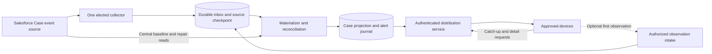

# ESRE case-alert data and distribution architecture

Research assessment and proposed design, 2026-11-12. This document translates 23 researched concepts and 342 structured claims into an implementation proposal. The continuation closes the three previously queued policy topics and the formerly partial Omni diagnostic. The [suite report](README.md) owns final coverage and publication status; the [scored scope](plan.json) records the research selection. This is not a deployed-system description or a migration authorization.

Centralize Salesforce ingestion in one elected collector. Persist accepted work in MongoDB, build a shared Case projection and alert journal, and push authorized updates through an application service. Devices should read that service's shared data and reconnect through its catch-up API. Central reconciliation and content hydration remain necessary upstream work.

The operator reports Atlas Global Writes with location-based sharding, an M30 in us-east-2 and about a dozen initial users. Treat these as supplied sizing assumptions, not inspected deployment facts. Start with the authorized recipient group and validate the chosen Atlas topology before extending distribution across regions. Keep Case descriptions and comments behind an explicit content policy. No Salesforce org, Atlas topology, access configuration or application runtime was inspected for this assessment. Physical shard keys, global lease authority, transaction routing, indexes, write concerns and regional placement remain deployment decisions to validate.

An approved existing synchronization feed could also supply the central intake. Evaluate its payload, severity-transition coverage, delay and recovery evidence before selecting it. This proposal removes repeated device discovery reads against a tertiary source; it does not assert that every upstream synchronization path is free of scheduled queries. Direct CDC remains conditional on verified org access and configuration.

## Choose the event source before designing delivery

Case lifecycle qualification should use Case changes rather than infer lifecycle changes from routing readiness. Salesforce defines `CaseChangeEvent`; Omni-Channel external routing instead describes work waiting for routing, assignment and agent interactions. Routing readiness is useful context, but does not establish that a later severity edit produced an alert. This separation is an architectural inference from the documented object and routing lifecycles. [Case object](https://developer.salesforce.com/docs/platform/object-reference/references/standard-objects/object-case.html), [PendingServiceRouting](https://developer.salesforce.com/docs/platform/object-reference/references/standard-objects/object-pendingservicerouting.html), [external routing flow](https://developer.salesforce.com/docs/service/service-presence-developer-guide/guide/omnichannel-external-routing-flow.html).

The [proposed application policy contract](application-policy-contract.md) now specifies event-first hybrid ingestion, immutable first-acceptance rule binding, episode/rearm/mute policy and durable timer lifecycle. It defines candidate behavior and acceptance traces; no application implementation or execution is implied. The underlying requirements remain:

- **Creation:** decide whether a Case already at the target severity when committed should alert. CDC can collapse creation and subsequent changes within one transaction into one CREATE event with final committed values.
- **Update:** qualify a change of the configured severity field, not just a record whose current severity matches a filter. Channel filters cannot test the array-valued `changedFields`; a state filter can also deliver unrelated-field updates.
- **Undelete, reopen and repeat escalation:** make separate product decisions. Do not infer these from the creation rule or suppress a legitimate later escalation with a lifetime Case-only deduplication key.

The first two behaviors are grounded in Salesforce's [general CDC considerations](https://developer.salesforce.com/docs/platform/change-data-capture/guide/cdc-general-considerations.html) and [stream-filter semantics](https://developer.salesforce.com/docs/platform/change-data-capture/guide/cdc-filters.html). The rule structure and repeat-alert policy above are proposed application behavior. The actual severity API field, value mapping and equivalence to an ESRE priority remain unknown; `Case.Priority` must not be assumed to mean the application's P1 classification.

Avro decoding precedes qualification. Decode the event schema and change-header bitmaps; distinguish unchanged, nulled and changed fields. An unchanged enriched field in a replay can reflect a later database value, so it is not historical proof of severity at the original event time. [Deserialization considerations](https://developer.salesforce.com/docs/platform/pub-sub-api/guide/event-deserialization-considerations.html), [enrichment considerations](https://developer.salesforce.com/docs/platform/change-data-capture/guide/cdc-enrich-considerations.html).

The supplied [Omni-Channel subscription guide](https://developer.salesforce.com/docs/service/service-presence-developer-guide/guide/omnichannel-external-routing-subscribe-to-change-data-capture-event-notificat.html) contains inconsistent channel spellings, including `ExternalRoutingChannel__chn` and `ExternalRoutingChannel_chn`, and inconsistent event naming between prose and examples. Treat these as attributed source inconsistencies requiring validation. A minimal [GetTopic check](https://developer.salesforce.com/docs/platform/pub-sub-api/references/methods/gettopic-rpc.html) is one proposed identity check; no target-org lookup was performed. The completed 43-fact Omni diagnostic now covers the exact documented presence predicate, metadata identity and capability/error procedure. The separate [proposed validation contract](omni-validation-contract.md) requires independently qualified metadata identity, topic capability, schema compatibility and delivery semantics. No target-org lookup, Avro compatibility execution or live delivery test was performed.

## Proposed service boundary



This composition is a proposal built from Salesforce Subscribe, MongoDB transactions and MongoDB change streams. Those APIs do not certify the combined application or provide an end-to-end exactly-once contract. MongoDB notifications occur after majority persistence, but that does not acknowledge an application's processing or a device's receipt. [Subscribe](https://developer.salesforce.com/docs/platform/pub-sub-api/references/methods/subscribe-rpc.html), [transactions](https://www.mongodb.com/docs/manual/core/transactions/), [change streams](https://www.mongodb.com/docs/manual/changestreams/).

Use a central native gRPC runtime for Salesforce. Subscribe requires bidirectional streaming; the official gRPC-Web browser client does not support that RPC mode. This supports a server collector with a separate browser interface as a design inference; it is not a claim that every alternative browser gateway is impossible. [Subscribe RPC](https://developer.salesforce.com/docs/platform/pub-sub-api/references/methods/subscribe-rpc.html), [official gRPC-Web client](https://github.com/grpc/grpc-web).

Keep standbys from subscribing during normal ownership. A paused former owner can overlap a replacement during failover, so the correctness contract is one accepted logical writer enforced at storage, rather than an unqualified promise that only one network connection can ever exist. Each Salesforce subscribed client contributes to delivery usage; distributing to devices behind the application avoids multiplying that upstream usage by device count. [Salesforce event allocations](https://developer.salesforce.com/docs/platform/platform-events/guide/platform-events-limits-default.html), [leader-election failure modes](https://aws.amazon.com/builders-library/leader-election-in-distributed-systems/).

## Keep progress markers separate

These are proposed application contracts. None of the markers below substitutes for another.

| Marker | Meaning | What it does not prove |
| --- | --- | --- |
| Salesforce feed checkpoint | Position through which the collector has durably accepted source work into its recoverable inbox. | Alert materialization, device delivery or user attention. |
| Materializer checkpoint | Inbox work whose Case projection and alert effects have committed. | Receipt by a connected device. |
| Journal position | Server-assigned ordering position within one distribution partition. | A Salesforce replay ID, global ordering across every partition, or receipt. |
| Device acknowledgment | Last contiguous journal position the named device has accepted under the documented client contract. | Another device's receipt or a person reading an alert. |
| User read state | An explicit user action on an alert, associated with that user. | Transport delivery success or suppression of another user's notification. |

Salesforce replay IDs are opaque stream positions; do not perform arithmetic on them or use them as a universal event identity. CDC enrichment can produce separate messages with the same ReplayId, and maintenance can affect replay identity. The journal therefore needs its own position and the materializer needs an independently validated deduplication contract. [Event durability](https://developer.salesforce.com/docs/platform/pub-sub-api/guide/event-message-durability.html), [CDC developer guide](https://resources.docs.salesforce.com/latest/latest/en-us/sfdc/pdf/salesforce_change_data_capture.pdf).

## Proposed logical data model

The names and fields below are a logical schema proposal, not inspected collections or validated Global Writes shard/index definitions. Include `schemaVersion` and server timestamps on every stored document. Preserve source occurrence time separately from server acceptance time.

| Collection | Important proposed fields | Purpose and retention boundary |
| --- | --- | --- |
| `source_inbox` | `tenantId`, `orgId`, `feedId`, `ingestId`, `ingestPosition`, `sourceKind`, `sourceTopic`, `schemaId`, opaque `replayId`, `transactionKey`, `sequenceNumber`, `recordIds`, `changeType`, `commitTimestamp`, `acceptedAt`, `collectorEpoch`, `dedupeKeyVersion`, candidate `dedupeKey`, minimized `payload`, `processingState` | Recoverable accepted source work. Retain until processed and beyond the adopted replay/reconciliation/forensic recovery window. Do not expire unprocessed work. |
| `feed_checkpoints` | `tenantId`, `orgId`, `feedId`, `lastAcceptedReplayId`, `lastAcceptedIngestPosition`, `collectorEpoch`, `updatedAt` | Source intake progress. Keep cursor bytes exact; encode losslessly at API boundaries. |
| `materializer_checkpoints` | `tenantId`, `orgId`, `feedId`, `lastProcessedIngestPosition`, `ruleVersion`, `updatedAt` | Restart materialization independently of the source connection. |
| `case_projection` | `tenantId`, `orgId`, full `caseId`, `caseNumber`, `severity: { normalized, sourceValue, mappingVersion }`, `severitySourceField`, `status`, `sourceVersion`, `lastSourceCommitAt`, `lastReconciledAt`, `reconciliationState`, `deleted`, `projectionVersion` | Shared current-state cache. Rule mapping is versioned; source values and normalized values stay distinguishable. |
| `case_content` | `tenantId`, `orgId`, `caseId`, approved description/comment records, source object/version, `fetchedAt`, `contentPolicyVersion` | Access-controlled content cache, separate from small alert envelopes. Comment-source and freshness mechanisms require their own validation. |
| `alert_journal` | `tenantId`, `scopeId`, `partitionId`, `journalPosition`, `entryId`, `alertId`, validated `effectKey`, `caseId`, `kind`, `ruleId`, `ruleVersion`, `sourceIngestIds`, `verificationState`, minimized summary, `occurredAt`, `acceptedAt`, `supersedesEntryId` | Append new alert/confirmation/correction events. Retention must support the promised offline catch-up window; publish a retained-history floor. |
| `device_progress` | `tenantId`, `userId`, `deviceId`, `scopeId`, `partitionId`, `lastContiguousAck`, `grantVersion`, `updatedAt` | Device receipt state; a reconnect requests everything after this position. |
| `user_alert_state` | `tenantId`, `userId`, `alertId`, `readAt`, optional user dismissal/acknowledgment | User interaction state kept separate from device transport acknowledgments. |
| `device_observations` | `tenantId`, `orgId`, `caseId`, `observationId`, `reporterUserId`, `deviceId`, `observedAt`, `receivedAt`, reported source version, minimized evidence, `verificationState`, `correlatedAlertId`, `expiresAt` | Optional provisional reports; client retry identity is separate from semantic alert identity. |
| `collector_ownership` | `tenantId`, `orgId`, `feedId`, `ownerId`, `epoch`, `leaseUntil`, `updatedAt` | Proposed ownership/fencing state. Authority, atomicity and multi-region failure behavior must be proven before use. |

Preserve the original event header and all `recordIds` needed to interpret merged or enriched changes. A candidate semantic identity might combine org/feed scope, transaction identity, sequence and record identity, but its sufficiency must be tested against the chosen channel configuration. A generated `ingestId` identifies our receipt; it does not prove that two source messages represent different business changes. Avoid claiming that a payload hash, ReplayId or `transactionKey` alone solves deduplication. `ingestPosition` orders the accepted local feed ledger; `entryId` identifies a journal entry, while `alertId` links its confirmations/corrections. Both position-allocation mechanisms require validation and are separate from Salesforce cursor bytes.

Apply controlled schema migrations: keep readers compatible during rollout, version normalized severity mappings and dedupe rules, and replay a representative retained inbox against a candidate materializer before promotion. Retain immutable source provenance sufficient to explain an alert without broadcasting the complete Case body.

## Proposed durable acceptance and processing

1. **Acquire validated ownership.** Obtain a new fencing epoch using a storage authority whose required failure semantics have been established. A lease in process memory is insufficient: a paused former owner may resume. The durable write path must reject its older epoch. [Kubernetes client-go explicitly does not provide fencing](https://github.com/kubernetes/client-go/blob/master/tools/leaderelection/leaderelection.go); the [original fencing-token explanation](https://martin.kleppmann.com/2016/02/08/how-to-do-distributed-locking.html) describes the storage-side check.
2. **Accept a bounded source batch.** Decode enough to validate the envelope and retain recoverable work. Atomically couple durable inbox acceptance with feed-checkpoint advancement and the required ownership guard. Advance only through a contiguous accepted prefix: later batches or keepalives must not skip earlier in-flight work. Treat durable intake as an explicit processing boundary, not as notification completion. Determine suitable transaction/read/write concerns for the actual deployment; the composition is an application design inference from the documented primitives.
3. **Advance source progress after acceptance succeeds.** A crash before commit must leave the source checkpoint behind; a crash after acceptance must leave inbox work recoverable. For ManagedSubscribe, commit the source replay position after durable acceptance; if that commit fails, tolerate replay of already accepted work. Do not move a checkpoint beyond work retained only in memory.
4. **Materialize idempotently.** Process accepted inbox work in the required per-Case/transaction order. Commit projection changes, new journal effects and materializer progress as one tested atomic unit. A retry should find the prior effect through its validated idempotency contract. Quarantine unsupported schema/rule cases durably and expose their stalled state; do not silently discard them.
5. **Distribute from the journal.** Use MongoDB change streams as wake-ups and query committed journal records. Each application distributor can serve many device connections. Budget database watchers per service instance instead of opening a MongoDB watcher for every device; an active stream holds a connection while waiting. [Change-stream behavior and connection guidance](https://www.mongodb.com/docs/manual/changestreams/).
6. **Replenish according to durable throughput.** Bound in-flight batches and request additional Salesforce demand according to storage acceptance capacity. An RPC error needs a new stream with an error-specific recovery policy. [Subscribe flow control](https://developer.salesforce.com/docs/platform/pub-sub-api/references/methods/subscribe-rpc.html), [retry guidance](https://developer.salesforce.com/docs/platform/pub-sub-api/guide/retry-rpc-calls.html).

The inbox/checkpoint transaction and materialization transaction are proposed boundaries that must be demonstrated with crashes and failover. A transaction API existing is not proof that the chosen schema, shard placement, ownership guard and journal-order allocation make those boundaries correct. Likewise, a fencing check performed before a pause is insufficient unless the accepting storage operation still enforces ownership when it commits.

ManagedSubscribe remains labeled Beta in the pinned official references. Administrative API STOP deletes its committed position and restart uses `defaultReplay`; ordinary disconnect is a different lifecycle. Do not use it as a leader-election protocol or assume a future GA commitment. [Managed subscriptions](https://developer.salesforce.com/docs/platform/pub-sub-api/guide/managed-sub.html), [ManagedSubscribe RPC](https://developer.salesforce.com/docs/platform/pub-sub-api/references/methods/managedsubscribe-rpc.html).

## Proposed query and device read path

The service derives allowed tenant, cohort and field policy from authenticated identity. A caller-supplied `scopeId` is not authorization. Devices receive no Atlas or Salesforce database credentials.

On startup, the service returns an authorized Case summary snapshot, the retained journal floor and a compatible catch-up cursor. It then sends journal updates over the chosen authenticated push transport. Reconnect always includes catch-up from the last contiguous accepted position; a websocket being open does not prove there were no missing journal entries. A cursor older than retention produces an explicit snapshot/reset response rather than a false “caught up” result.

The following is proposed MongoDB query pseudocode over the application's fields. These are not Salesforce API field names or an implemented endpoint contract:

```javascript
// Server-derived authorized scope; one ordered journal partition.
db.alert_journal.find({
  tenantId: authorizedTenant,
  scopeId: authorizedScope,
  partitionId: selectedPartition,
  journalPosition: { $gt: lastAcceptedPosition }
}).sort({ journalPosition: 1 }).limit(pageSize);

// Shared current-state view; returned fields come from server policy.
db.case_projection.find({
  tenantId: authorizedTenant,
  orgId: authorizedOrg,
  deleted: false,
  "severity.normalized": { $in: allowedAlertSeverities }
}, allowedSummaryFields);

// Detail endpoint repeats access checks before reading cached content.
db.case_content.findOne({
  tenantId: authorizedTenant,
  orgId: authorizedOrg,
  caseId: authorizedCaseId
}, allowedContentFields);
```

Propose equality-prefix indexes for the journal scope/partition plus ordered position, and for Case identity and the actual summary query. Propose uniqueness constraints for source dedupe and materialized alert effects only after their keys are validated. The journal position is ordered within a declared partition; its allocation mechanism is unresolved. Do not use a Salesforce replay ID or an ObjectId timestamp as an assumed global application ordering guarantee.

For Global Writes, validate each proposed index and uniqueness rule against the selected physical shard key before creating it. Choose the data-residency/write-locality model and authoritative ownership region deliberately. No assessment here establishes a legal shard key, a global sequence, a failover-safe lease, cross-shard transaction performance or an RPO/RTO for a selected deployment.

Description and comment reads should hit the authorized shared content cache. Central hydration can refresh missing/stale content in bounded batches. Confirm which source entities and mechanisms provide comments and their edits/deletions; a Case event feed alone has not established complete comment freshness. This prevents the design from promising zero upstream reads while requiring data it has not actually captured.

## Optional first-device observation intake

Yes, a device that first sees a Case can submit an observation to the server, which can make the result available to other authorized devices. This is an optional application proposal alongside the dedicated collector, not a reason for every device to create a Salesforce subscription or run continuous searches.

Accept only authenticated reports within the reporter's approved Case/cohort scope. Require an idempotent `observationId`, full Case identity, observation time, reported source version when available and the minimum evidence needed to correlate it. Treat client timestamps, severity values and supplied descriptions as untrusted input. Rate-limit and audit intake; do not accept a reported cohort or recipient list as an authorization grant.

Deduplicate retransmission of the same observation separately from correlating distinct devices' observations with a real Case transition. A Case-only key can suppress later legitimate escalations, while an arbitrary time bucket can merge different incidents. Define and validate the correlation contract before enabling provisional alerts.

If the trusted shared projection or central feed confirms the report, link it to the canonical alert. Otherwise either hold it for verification or publish a clearly labeled provisional observation to the authorized cohort under an explicit product policy. Confirmation, correction and withdrawal should append journal events linked to that provisional item. An observation does not advance the Salesforce checkpoint, establish a historical severity transition or justify wider dissemination. Verification should use the central pipeline/cache; any necessary source read remains a bounded server operation.

## Authorization and content governance

Separate the collector's source rights from the application's recipient policy. CDC ignores record sharing, checks field permissions for the subscribed user, and can expose schema fields that user cannot access. Collector visibility and schema membership therefore do not establish what each alert recipient may read. [CDC security considerations](https://developer.salesforce.com/docs/platform/change-data-capture/guide/cdc-security-considerations.html), [field security](https://developer.salesforce.com/docs/platform/change-data-capture/guide/cdc-security-field.html), [required permissions](https://developer.salesforce.com/docs/platform/change-data-capture/guide/cdc-security-perms.html).

For the initially approved team, use an explicitly administered recipient cohort with a documented Case/field scope and revocation process. Recheck that policy for live delivery, catch-up, search, details, comments and device-observation intake. Revoke existing realtime sessions as well as subsequent HTTP requests; changing the collector's account is not a recipient-revocation mechanism.

Keep push envelopes small: alert identity, Case reference, normalized severity, verification state and journal position, with only approved summary fields. Fetch description/comment details through the policy-checked cache endpoint. Define separate retention, audit, export and deletion rules for source payloads, content, alert history and interaction state. Select approved encryption/key management and secret storage during implementation; no deployed encryption configuration has been verified here.

## Reconciliation is part of normal operation

Salesforce documents 72-hour event retention, with no guarantee beyond it, and rare CDC persistence failures that replay cannot repair. Gap and overflow events also require authoritative data repair. Maintain a central baseline and periodic bounded reconciliation instead of treating a healthy stream as proof of a complete replica. [Event durability](https://developer.salesforce.com/docs/platform/pub-sub-api/guide/event-message-durability.html), [CDC limitations](https://developer.salesforce.com/docs/platform/change-data-capture/guide/cdc-when-to-use.html).

Follow pagination when hydrating a baseline. For a gap, reconcile every affected `recordIds` member and control intervening updates for records under repair. For overflow, use the documented entity resynchronization pattern, including deletions and replay after the saved position. Current-state repair cannot reconstruct every lost historical alert. [REST query pagination](https://developer.salesforce.com/docs/platform/api-rest/guide/resources-query.html), [transaction-based replication and recovery](https://developer.salesforce.com/docs/platform/change-data-capture/guide/cdc-replication-steps.html).

MongoDB change-stream history is also bounded by retained oplog history. If notification resume fails, rebuild distribution from the retained journal and its published floor; do not make notification history the only alert record. Monitor both source lag and application journal lag. [MongoDB change streams](https://www.mongodb.com/docs/manual/changestreams/).

## Acceptance and failure matrix

All outcomes below are proposed acceptance criteria. None has been demonstrated against this application's live path.

| Drill | Required observable outcome |
| --- | --- |
| New Case already qualifies at commit | One canonical alert per chosen creation rule; no UPDATE-only blind spot. |
| Severity upgrade, unrelated update, downgrade and later re-upgrade | Qualification follows the versioned rule; unrelated updates do not create false transitions; repeat escalation follows explicit policy. |
| Empty/nulled fields, CREATE, compound fields, schema change | Decoder/qualifier produces the expected state or a durable quarantine; no silent drop. |
| Duplicate replay and enriched messages sharing ReplayId | Retries do not duplicate the same effect; distinct record changes survive deduplication. |
| Crash before inbox/checkpoint commit | Source progress remains behind; replay recovers the unaccepted work. |
| Crash after durable intake, before materialization | Restart processes retained inbox work despite an advanced intake checkpoint. |
| Crash after materialized alert, before source/driver acknowledgment | Repeated delivery finds the committed effect; no extra alert for the same validated identity. |
| Collector pauses after checking ownership; replacement acquires ownership | Storage rejects the resumed old owner's stale-epoch writes and checkpoint advancement. |
| Disconnect, gap, overflow, expired replay and missed persistence | The defined reconnect/repair path runs; current-state health and historical-alert uncertainty are reported separately. |
| MongoDB notification resume token no longer works | Distributor catches up by querying the durable journal or explicitly requests a snapshot reset. |
| Device offline, duplicate push, out-of-order push and lost acknowledgment | Contiguous cursor catch-up converges without treating delivery as user read. |
| Recipient revoked while connected | Live connection, history/details and observation intake enforce the new grant; no sensitive payload continues under a stale policy. |
| Spoofed/stale device report and simultaneous reports from two devices | Unauthorized reports are rejected; authorized uncertainty stays provisional; retry dedupe and semantic correlation remain distinct. |
| Storage slows or subscription entitlement is exhausted | Bounded backpressure and explicit degradation; no unbounded memory growth or hidden per-device fallback polling. |
| Global Writes regional interruption or shard movement | Validated ownership and durability behavior meets the chosen recovery objectives; unknown guarantees block rollout. |

Measure source occurrence-to-intake, intake-to-materialization, journal-to-device acknowledgment, reconciliation freshness, retained-history floor and authorization revocation latency separately. Set target values with the team before rollout; no latency SLA was established by this research. An Apex event test alone does not execute the external Pub/Sub subscriber, so acceptance must exercise the entire intended path. [Salesforce event testing scope](https://developer.salesforce.com/docs/platform/platform-events/guide/platform-events-test-events.html).

## Development sequence and unresolved inputs

1. Finalize the org contract: Case/severity mapping, enabled CDC entities, topic identity, source visibility, comment coverage and actual event/API entitlements. Review the intended recipient cohort independently of collector permissions.
2. Prove the logical persistence boundaries against a test dataset and the intended Atlas topology. Validate indexes/shard keys, stale-owner rejection, both checkpoint boundaries and journal ordering before connecting production sources.
3. Run an isolated collector/materializer against synthetic or authorized test events. Execute the failure matrix and document recovery limits. Compare the projection with authoritative reads using bounded reconciliation.
4. Pilot authenticated push and catch-up for a small approved cohort; measure the actual loaded device path and revocation behavior. Keep descriptions/comments behind policy-checked detail reads.
5. Enable optional device observations only after the provisional/correlation policy passes adversarial and duplicate tests. Retire per-device upstream search only after central discovery and reconciliation meet the agreed acceptance criteria.

| Input still required | Why it blocks a final deployment choice |
| --- | --- |
| Actual severity field/value/rule mapping | Determines qualification, filters, replay interpretation and repeat-alert identity. |
| Enabled CDC entities and exact metadata/topic identity | Determines whether the intended Case and comment signals exist and how to subscribe. |
| Org edition/add-ons, event/API entitlements and integration-principal visibility | Determines permitted subscription, allocation headroom, hydration and the breadth of ingested data. |
| Approved recipient/field cohort and revocation authority | Determines who can receive summaries, descriptions, comments and history. |
| Atlas physical topology, shard keys, transaction concerns and ownership authority | Determines whether proposed durability, uniqueness, ordering and fencing are enforceable. |
| Alert history, raw-payload/content retention, offline window and recovery objectives | Determines storage lifecycle and what catch-up/reconciliation may promise. |
| Runtime, deployment region and browser push transport | Determines supported client libraries and actual end-to-end behavior to test. |

The intended outcome is a shared, durable alert service with centralized upstream work and explicit recovery. Publication of this assessment does not establish that the org configuration, Atlas design, proposed schemas, security policy or device-delivery contract has passed those deployment gates.
