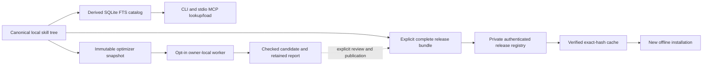

# Private skill registry and optional optimizer

Version: 1.0.0. Date: 2026-11-11. Access decision: private for the owner and
explicitly authorized teammates first.

The registry makes scattered skills discoverable, distributes complete pinned
skill releases, and tracks optional optimization candidates. The standalone
local package works without a hosted account. The hosted adapter reuses
LLMS-Explorer accounts, scoped keys and PostgreSQL.

## Authority and retrieval

| Object | Authority | Derived or distributed copies |
| --- | --- | --- |
| Editable local skill | Canonical source tree | SQLite FTS catalog and installation aliases |
| Shared skill version | Immutable account/name/version manifest and verified bundle | Exact-hash cache and offline installations |
| Optimization input | Immutable snapshot and input identity | Isolated candidate tree and private logs |
| Research assertion | Existing research evidence and validation contract | Existing graph/vector projections; the registry does not promote assertions |

Each object has one authority. A published version never follows later local
edits. Publish another version to distribute a change.

The local ID derives from the canonical `SKILL.md` path. Same-name sources remain
separate, while aliases point to the same canonical source. Refresh runs on
lookup or in polling watch mode. Source loading checks the current SHA256 and
returns bounded character spans with continuation offsets and a resource base.
Configured roots can include user, plugin, hub and project skill locations.
An optional adapter reuses Skills Explorer's pure inventory code.

Exact skill names, source paths and alias folder names take priority over general
BM25 matches. Native optimizer selection uses a direct exact lookup with a fresh
source hash check. A live policy demonstration found that generic optimizer
mentions could bury an installed definition below the lexical result limit;
the resolver no longer depends on that result limit.

Routing currently uses lexical search over `SKILL.md` bodies. It does not embed
every supporting reference or prove which skills a native harness has loaded.
Coverage limits and parse failures remain visible. Activation is unknown without
loader evidence; explicit matching Codex disable decisions are surfaced and
preserved. A lookup result is a candidate workflow that the current agent must
select deliberately.

## Portable private releases

The shared `skill-release/v1` validator binds namespace, name, exact semantic
version, entrypoint, description and every approved resource's relative path,
byte length, SHA256 and executable flag. Release identity hashes canonical
manifest JSON, independently of ZIP timestamps. Complete colocated references,
scripts, templates, evals, assets and licenses travel with the skill.

Validation permits at most 128 files, 2 MiB per file, 5 MiB expanded and 6 MiB of
ZIP data. It rejects traversal, symlinks, special modes, encrypted members,
duplicate or case-colliding paths, extra or missing members and checksum
mismatches. Packaging checks for concurrent tree changes. Credentials, `.env`
files, VCS/cache/build directories and old installation receipts are excluded.
External absolute resource pointers and runtime dependencies require a separate
portability review; a checksum does not prove quality, licensing or execution
safety.

The hosted release stores its bounded ZIP and manifest in one database
transaction. An immutable database trigger also rejects content updates. Reusing
the same account/name/version with the same identity is idempotent; different
content returns 409. The publishing namespace must be the authenticated account.
Default quotas are 500 releases and 100 MiB per account.

| Operation | Account authority |
| --- | --- |
| Search, metadata, exact bundle download | `read`; owner or explicit version grant |
| Publish, grant, revoke | `publish`; release owner |
| Read an optimizer job | `read`; job owner |
| Create, claim, heartbeat, complete, cancel a job | `read` and `run`; job owner |

Grants target an existing account and one immutable release version. A read grant
does not authorize optimization or publication on the owner's behalf. Public
uploads are rejected; moderation and public community discovery are outside
this release. Cookie-authenticated mutations require the platform's AJAX/CSRF
header. Bearer keys use the existing scoped-key boundary.

Private successes and errors carry `Cache-Control: private, no-store` and vary
on authorization/cookies. Body limits apply while streaming, before JSON
parsing. The client requires HTTPS except loopback HTTP, refuses redirects and
keeps credentials in an environment variable or a mode-600 token file. Fetch
requires an exact release hash, verifies before caching, and can then install
offline. Installation uses a no-clobber rename on macOS/Linux and cannot replace
an existing destination.

## Optional optimization

| Artifact kind | Native definition selected |
| --- | --- |
| Skill | `skill-optimizer` |
| Code | `code-deep-optimizer` |
| Document | `ddo` |
| Query | `deep-query-optimizer` |
| Prompt | `prompt-deep-optimizer` |
| Agent | `agent-deep-optimizer` |

The registry locates an installed native definition and records a missing one as
a limitation. It does not equate a generic model rewrite with full execution of
that definition. Skill input identity binds the approved complete resource tree,
including executable flags. Other artifact jobs are single-file UTF-8 inputs;
multi-file repository snapshots require another adapter.

Automatic policies are disabled by default. Each enabled skill policy must refer
to a configured writable source. Polling refresh can queue changed or stale
inputs, with a default cap of one job per cycle, a 24-hour interval, a 600-second
deadline and three iterations. Without a configured trusted backend, scheduling
queues jobs and reports that it has not executed them.

Workers use private immutable originals, separate candidates, leases, bounded
argv execution, cancellation and retained logs. Configured checks share the
execution deadline. Original and candidate identities are checked after checks,
and root symlink swaps are rejected. SIGINT/SIGTERM stop the child process group,
persist cancellation and exit 130/143. Accepted cancellation wins atomically
against completion. SIGKILL or host failure can leave uncertain attempts; an
explicit retry starts another workspace while retaining the prior attempt.

Execution, configured checks, native convergence and publication are separate
fields. A model or external worker's convergence report remains unverified;
exit zero never independently establishes convergence. Successful checks make
a candidate reviewable. They never overwrite the source or publish a release.
The built-in Codex adapter restricts MCP/tool network access for its subprocess.
Registry credentials are stripped from worker/check environments. Configured
commands still run as the local operator; this is a trusted local worker,
not a multi-tenant execution sandbox. Log byte quotas and retention automation
remain future operational work.

The hosted `/api/jobs` broker accepts owner-scoped snapshots and lease reports.
It never executes uploaded scripts or starts model work in an HTTP handler.
An owner's `remote-work` process claims the job, verifies the snapshot, runs
locally, renews the lease and submits the exact checked candidate. Failed network
reporting retains a private recovery binding. Default hosted caps are five
active jobs and 25 new jobs per account per day. Completion distinguishes
server validation from worker-reported execution and checks.

## Entry points and checks

The standalone package supplies `skill-registry` and `skill-registry-mcp`.
The MCP extra uses SDK v1.30 (`mcp>=1.30,<2`) and exposes 16 bounded tools for
lookup/loading, release distribution, policies and job lifecycle operations.
MCP callers cannot change configured roots or supply arbitrary executable argv.

The focused Skill registry workflow installs the frozen standalone lock on
Python 3.13, runs Ruff and exercises catalog, bundle, lifecycle, client and real
stdio protocol tests with temporary fixtures. Existing API CI runs actual
PostgreSQL tests for account isolation, quotas, grants/revocation, immutable
versions, streamed limits, leases and report binding. Tests do not invoke a paid
model. Installed CLI/MCP behavior, real optimization and remote deployment need
their own acceptance receipts; passing source tests do not establish them.

The adjacent `skill-registry.postman_collection.json` is a read-only v2.1
collection. Set `baseUrl` and a private local `token` value. Search requests run
without release data; pinned metadata/download and existing-job checks skip until
their explicit identifiers are set. Requests use `User-Agent: skill-registry/0.1.0`.
The collection never publishes a release, grants access, creates a job or executes
an optimizer. Disable cookie sending when testing the anonymous boundary.
